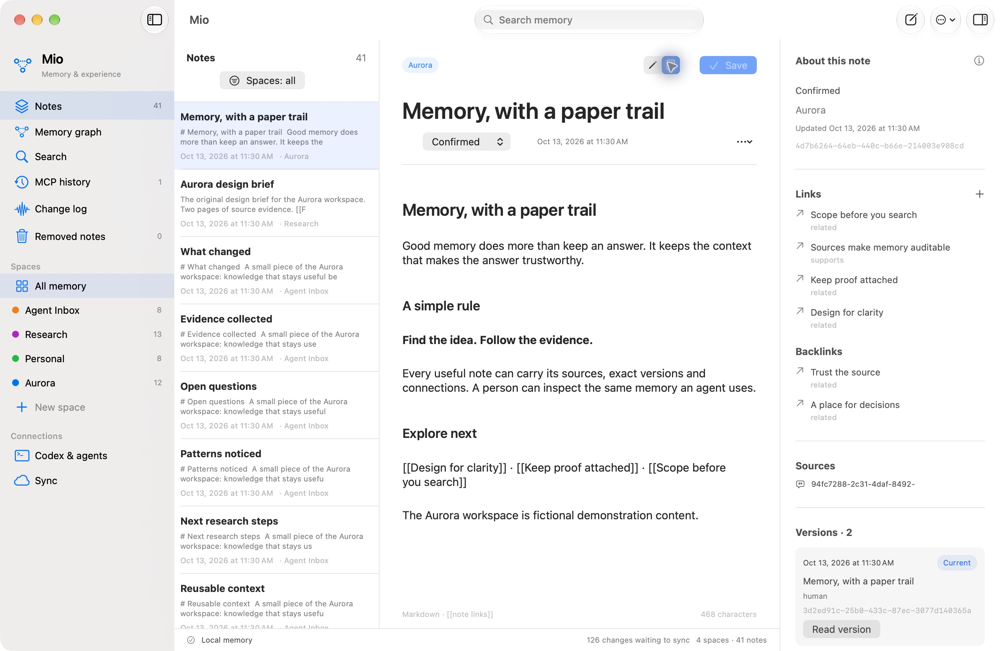
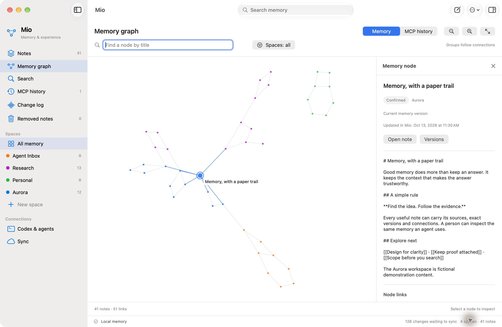
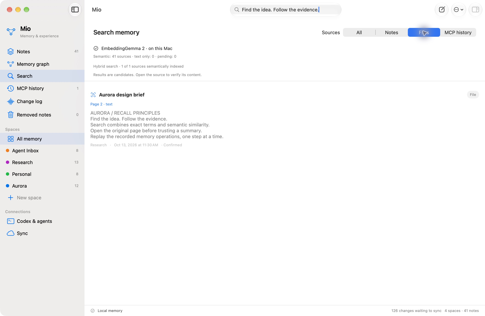
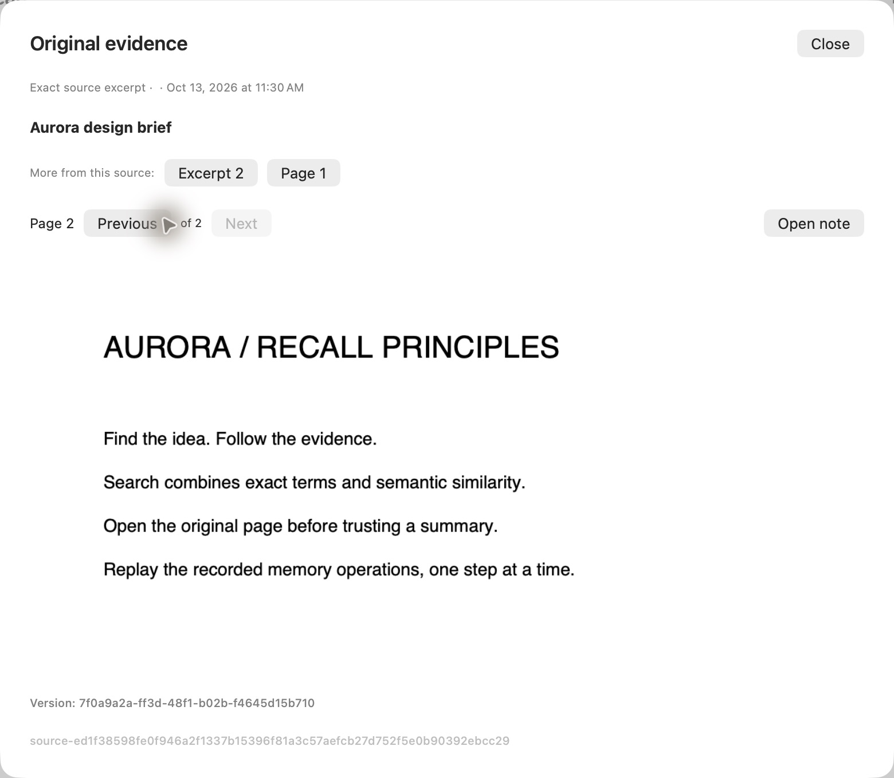
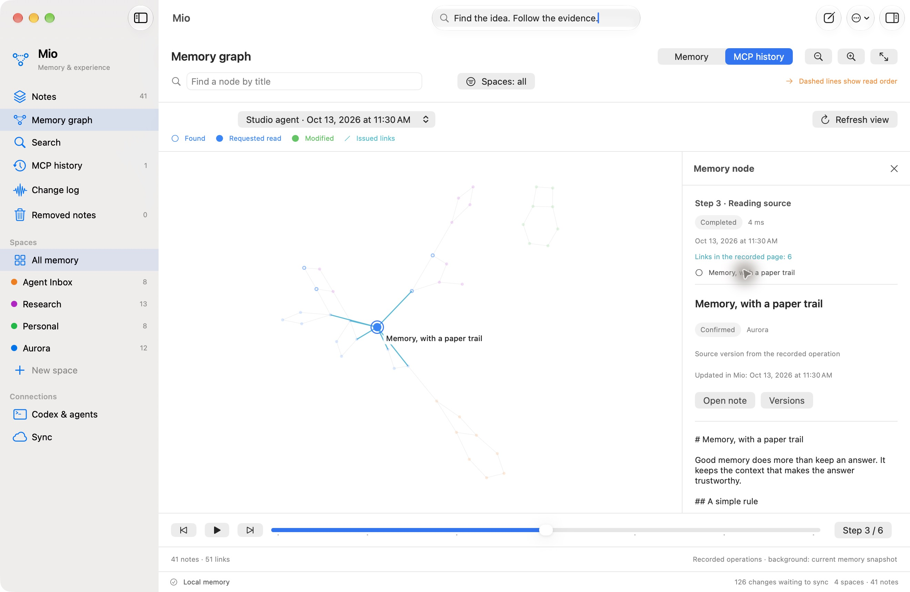
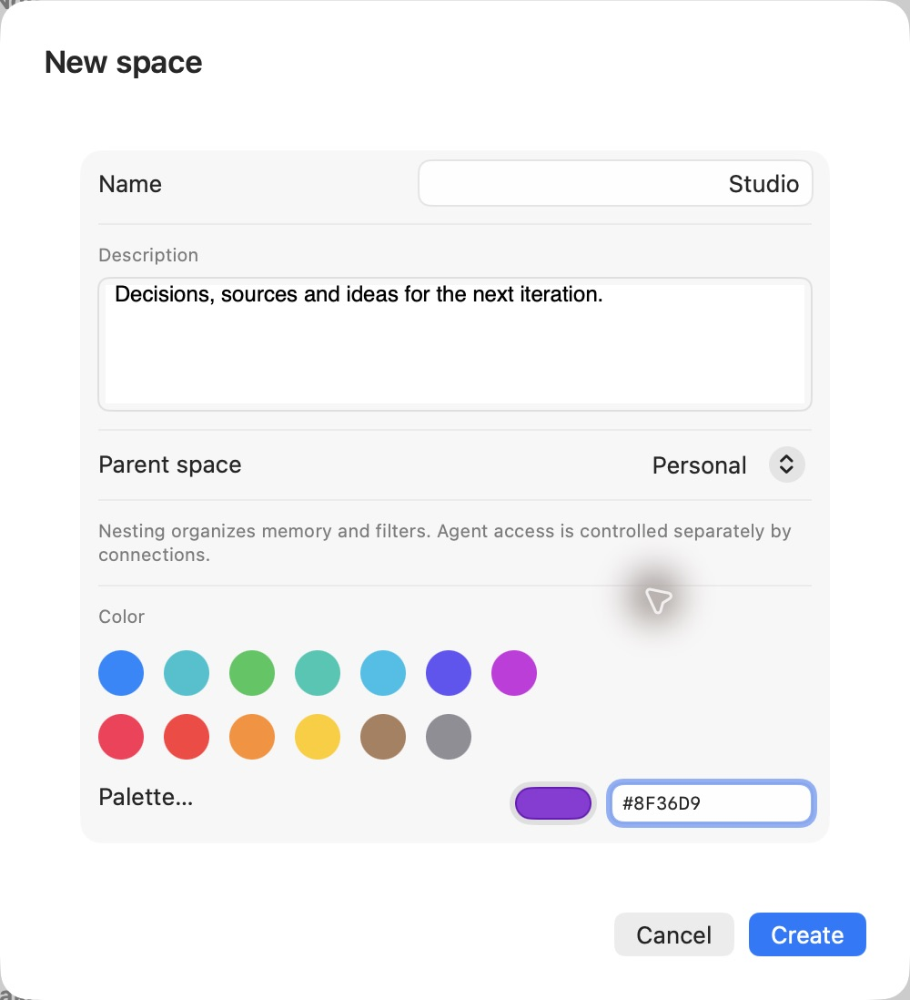

<div align="center">

# Mio

### Memory, made visible.

A native macOS workspace for the knowledge your agents use — and the evidence you want to inspect.

[Explore the features](#a-memory-you-can-explore) · [Build Mio](#get-started) · [Connect an agent](#connect-your-agent) · [MCP reference](docs/MCP.md)

**macOS 15+ · Apple Silicon · Local-first · MCP · MIT**

</div>

Mio gives an agent a durable memory of notes, files, sources and connections. You can read that same memory in a native Mac interface, explore its graph, and replay how an agent searched and moved through it.

Think linked notes with an agent-facing API: a place for useful context that stays understandable to a person.

## A memory you can explore

| For your agent | For you |
| --- | --- |
| Search notes, PDF pages, images and past memory operations. | Inspect the exact source, page and version behind a result. |
| Follow links one note at a time. | Explore the full graph and inspect a node in a side panel. |
| Read and write within explicitly permitted spaces. | Keep projects separate and choose which spaces to connect. |
| Capture knowledge with sources and revise it safely. | Review versions, competing edits and the operation history. |

### Keep the context close

Markdown notes, `[[wikilinks]]`, typed relationships, sources and version history belong to one shared memory graph. Agent-created links and note links use the same graph.



### See the connections

The graph draws the whole memory as lightweight nodes and edges. Click a node to inspect its content in a side panel. Highlight one or several spaces; the rest stays visible and almost transparent.



### Find the idea. Follow the evidence.

Search combines **BM25** and **local EmbeddingGemma 2 embeddings** with reciprocal-rank fusion. It can return note passages, PDF pages, image/OCR sources and Mio operation history. Results carry source IDs, versions and locators so the next step is a precise read.

Keyword search remains available while the semantic model is missing or indexing.





### Understand what your agent did

Replay recorded MCP operations step by step: searches, reads, changes and the links issued to the agent. Historical note views use the recorded version. The background graph is explicitly identified as current memory.

This is a history of **Mio memory operations**: requests, outcomes, timing, results and changes.



## Get started

Mio is an early developer preview for **Apple Silicon Macs running macOS 15 or newer**. Building requires full Xcode, Swift 6.2 or newer and Python 3. The app itself uses native Swift, Metal and bundled SQLite; Python is only used by build and development scripts.

```sh
git clone https://github.com/raven-ai-esh/mio.git
cd mio

python3 scripts/build-app.py --dmg
python3 scripts/check-package.py
python3 scripts/install-local.py
open /Applications/Mio.app
```

The build produces a ZIP and DMG in `dist/`. The installer verifies the package and preserves the previous app as a recoverable ZIP before replacing it.

The developer build is locally signed **ad hoc**, not notarized. Developer ID distribution is a future release step. See [building and testing](docs/BUILDING.md).

### Organize your memory

Select several notes with **⌘-click** or **Shift-click**. Move them to another space, change their status, or remove them together. Drag a note or selection onto a space in the sidebar to move it. Note IDs, links, files and version history stay attached; removed notes can be restored.

Right-click a space to edit its name, description and color, create a child space, or change its parent. Choose a base color, open the native macOS color palette, or enter an exact **#RRGGBB** value. The same color appears in the sidebar, filters and graph.

**Drag spaces to organize them:** drop between rows to reorder siblings, or onto the middle of a row to nest a space. Drop onto **All memory** to return a space to the top level. Native insertion lines and row highlights show the destination before you release. Order and hierarchy persist across launches and are included in memory sync/export.

Choosing a parent highlights its descendants in Notes and the graph. Agent access connections are shown separately and remain explicit; nesting never grants additional access. Agents can discover the same authorized hierarchy through `read(kind="spaces")`.

<p align="center">
  
</p>

### Smoother background work

Mio 0.5.1 replaces repeated Swift record decoding with indexed SQLite reference checks and keeps iCloud connection/error-status work off the main thread. Unchanged background status no longer triggers redundant workspace updates.

On the same isolated release-build fixture — 64 notes with 70.8 KB bodies and 512 links — median queue-check time fell from **87.7 ms to 5.9 ms**. A concurrent owner read waited **9.4 ms instead of 85.8 ms**. These measurements cover this storage bottleneck, not an overall app-speed or iCloud-delivery guarantee.

### Your first workspace

1. Create a space for a project.
2. Add a note, import Markdown, or attach a PDF/image.
3. Connect an agent from **Codex & agents**.
4. Open **Memory graph** to inspect connections or **MCP history** to replay operations.

Choose **System language**, **English** or **Русский** in **Mio Settings → Interface language**. Changes apply immediately and persist between launches. Your notes and space names keep their original language.

## Connect your agent

Mio exposes five focused MCP tools:

| Tool | Purpose |
| --- | --- |
| `search` | Hybrid retrieval across authorized memory and operation history. |
| `read` | Read a note, source, event or session; discover the authorized space catalog. |
| `capture` | Create knowledge with sources, or capture a PDF/image. |
| `revise` | Create a version from an expected revision; preserve conflicting edits. |
| `link` | Connect notes with a typed relationship. |

In **Codex & agents**, create a profile, choose its home space, then install or copy the generated MCP configuration. The profile token is shown once. A profile can access its home space and explicitly connected spaces; following a graph edge does not expand its permissions.

An agent can start with:

```json
{"kind": "spaces"}
```

Pass this to `read` to receive space names, IDs, read/write permissions and the default space. Choose a name, then use its ID in `search.space_ids` or `capture.space_id`. Duplicate names remain distinct IDs.

After installing or updating the connection, reconnect the MCP client to load the current tool schema. See the [MCP reference and examples](docs/MCP.md).

## Local by design

- **SQLite with FTS5** is the local source of truth. Notes, versions, relationships and the operation log are durable.
- **Local embeddings** run on your Mac through a native Swift/MLX worker. The optional text and vision model download is approximately 514 MB.
- **Optional iCloud Drive sync** exchanges individual memory records through a folder you select. Local persistence and cloud delivery have separate states.
- **Import and export** support full memory archives and Markdown/Obsidian workflows.

App data lives in `~/Library/Application Support/app.mio.memory`. Embedding model files live in the app's cache directory. Tokens stay local and are excluded from memory replica/archive records.

## Current scope

Mio currently targets macOS. The interface supports English and Russian. Attachments support PDF, PNG, JPEG, HEIC, WebP and TIFF; audio/video attachment ingestion is not implemented.

The cloud path has been exercised on one Mac. Physical multi-device sync acceptance, iOS/iPadOS and notarized public binaries are future work.

All screenshots use the fictional **Aurora** demonstration workspace. The source snapshots contain no personal memory.

## Development

```sh
swift test
python3 scripts/check-space-catalog.py \
  --executable /Applications/Mio.app/Contents/MacOS/Mio \
  --receipt artifacts/catalog-check.json
```

The catalog check creates an isolated synthetic database and profile, exercises real stdio MCP → authenticated Unix IPC → SQLite, then stops its test service.

Read the [architecture](docs/ARCHITECTURE.md), [build guide](docs/BUILDING.md) and [contribution notes](CONTRIBUTING.md).

## License

Mio is released under the [MIT License](LICENSE). Vendored components retain their own licenses and notices; see [third-party acknowledgments](THIRD_PARTY.md).

---

<div align="center">

**Built for agents. Designed for people.**

A [Raven](https://github.com/raven-ai-esh) project.

</div>
